# NOXH Open Platform

Giải pháp mã nguồn mở của **BDSG Foundation** cho nhà ở xã hội: một chủ đầu tư, nhiều dự án, cổng công dân và kênh Zalo dùng chung backend. Giấy phép **MIT**.

**Bản tích hợp 16/10/2026 đang nghiệm thu:** cổng khách hàng, chủ đầu tư, nhân viên và đối tác; giấy tờ riêng tư, tạo PDF theo mẫu đã duyệt, tiếp nhận–xét duyệt hồ sơ, quy trình dự án, bảng hàng và bốc thăm diễn tập có kiểm chứng. Tiếp nhận thật và bốc thăm thật chưa được mở. Xem [phạm vi triển khai và phần còn thiếu](docs/IMPLEMENTATION-MATRIX.md).

[](https://github.com/BDSG-VN/noxh-open-platform/actions/workflows/ci.yml) Blueprint v2 được lưu nguyên bản tại [docs/blueprint](docs/blueprint/README.md); lựa chọn MIT thay thế đề xuất AGPL trong tài liệu gốc.

## Luồng mới trong bản tích hợp

- Chủ đầu tư soạn và duyệt độc lập checklist giấy tờ/mẫu; khách thấy phần còn thiếu dựa trên chứng cứ sạch và PDF đã xác nhận đúng phiên bản.
- Tri thức AI có nguồn, phạm vi và revision; trợ lý đề xuất điền PDF từ dữ liệu khách đã kiểm tra, chờ xác nhận riêng và không tự nộp hồ sơ.
- Mua/thuê/thuê mua có hợp đồng diễn tập, kỳ thu, chứng từ, đối soát, bàn giao và kết thúc với phân quyền, duyệt độc lập và kiểm tra phiên bản.
- Thông báo trong ứng dụng có mẫu được duyệt, lựa chọn mục đích/kênh, hàng đợi và lịch sử gửi. Ba sự kiện yêu cầu bổ sung/chấp thuận/từ chối hồ sơ có thể tự tạo thông báo diễn tập theo quy tắc được duyệt độc lập, chống trùng và kiểm lại đồng ý; mặc định tắt. Adapter email/Zalo thật cần được đơn vị triển khai cung cấp.
- Mini App tiếp tục cùng hồ sơ sau liên kết danh tính; gói khôi phục mã hóa có manifest, kiểm tra hash và diễn tập PostgreSQL/kho tệp/audit cô lập.

Các tài liệu [hồ sơ](docs/COMPLETION-DOSSIERS.md), [AI](docs/COMPLETION-AI.md), [hợp đồng](docs/COMPLETION-TENANCY.md), [thông báo](docs/COMPLETION-NOTIFICATIONS.md), [danh tính](docs/COMPLETION-IDENTITY.md) và [khôi phục](docs/RECOVERY-BUNDLE.md) mô tả API, quyền và phần chưa nghiệm thu. Các chức năng diễn tập không tự mở tiếp nhận, ký, thanh toán hoặc bốc thăm thật.

## Chạy bằng Docker

Yêu cầu Node 22.12+ hoặc 24, pnpm 11.25.0 và Docker Engine/Desktop có Compose. Image ứng dụng tự biên dịch các binary Rust bằng toolchain **1.99.0**; máy chạy Docker không cần cài Rust riêng.

```sh
git clone https://github.com/BDSG-VN/noxh-open-platform.git
cd noxh-open-platform
node scripts/init-dev-env.mjs
docker compose config --quiet
docker compose up --build --wait --wait-timeout 600
```

Lần build đầu cần tải và biên dịch MinIO từ commit nguồn chính thức đã khóa; các image giữ giấy phép gốc, xem THIRD_PARTY_NOTICES.md.

Cổng công dân: http://localhost:3000; chủ đầu tư: http://localhost:3001; minh bạch: http://localhost:3002; API: http://localhost:4000/health/live và /health/ready; Keycloak local: http://localhost:8080; MinIO console local: http://localhost:9001. Tài khoản kỹ thuật local được sinh vào `.env` (không commit). Bucket `noxh-private` bị tắt anonymous access. Đây là cấu hình **development**, không dùng `start-dev` hoặc credential root cho production.

```sh
# Worker AI tùy chọn; không gọi dịch vụ AI bên ngoài
docker compose --profile ai up --build --wait --wait-timeout 600
# Dừng dịch vụ, giữ toàn bộ volume
docker compose down
```

Không dùng `down -v` nếu cần giữ dữ liệu. Migration chạy trước API; seed chỉ chứa dữ liệu giả lập. `/health/ready` kiểm tra Postgres, Redis, migration 001–023 và khả năng truy cập/thực thi ba binary Rust; Compose chạy API/worker bằng login tối thiểu `noxh_api` (thành viên `noxh_app`, không DDL/BYPASSRLS/superuser) và readiness thất bại nếu kết nối bị nâng quyền, xem [vai trò DB tối thiểu](docs/COMPLETION-OPERATIONS.md#vai-trò-db-tối-thiểu-cho-runtime-022); không chứng minh thuật toán đã được kiểm toán hay đăng nhập/storage/legal readiness. API danh mục đọc dự án đã công bố từ Postgres, có nhãn riêng cho dữ liệu giả lập.

Thông báo nghiệp vụ tự động chỉ chạy khi bật `NOTIFICATIONS_AUTOMATION_ENABLED=true`, cấu hình rõ `AUTH_ORGANIZATION_ID` và có quy tắc/mẫu được duyệt cùng đồng ý hiện hành của khách. API và worker dùng cùng khóa mã hóa. Chỉ dữ liệu giả lập, kênh trong ứng dụng; xem [phạm vi và cách kiểm tra lát cắt021](docs/COMPLETION-NOTIFICATION-AUTOMATION.md). Gửi email/Zalo thật qua worker chỉ bật với `NOTIFICATIONS_EXTERNAL_ENABLED=true`, `NOTIFICATIONS_SMTP_ALLOWED_HOSTS` (tùy chọn `NOTIFICATIONS_SMTP_CA_FILE`), cấu hình nhà cung cấp mã hóa của tổ chức và kênh dự án được rà soát dữ liệu bật; mặc định tắt và chưa nghiệm thu nhà cung cấp thật, xem [lát cắt 023](docs/COMPLETION-NOTIFICATIONS.md#lát-cắt-023--gửi-thật-qua-worker).

## Bản trải nghiệm mở

`DEMO_OPEN_ACCESS=true` bật dự án hư cấu **Mây Trắng** với tài khoản công khai: số `0900000xxx` đăng nhập bằng mã cố định điền sẵn, quản trị `demo.admin` có mật khẩu và mã hai bước hiển thị tại `/trai-nghiem`. Chỉ cho dữ liệu giả lập; xem [OPEN-DEMO.md](docs/OPEN-DEMO.md).

## Đăng nhập và quản trị

Xem [hướng dẫn thiết lập Keycloak, admin và Zalo OTP](docs/ADMIN-AND-ZALO.md). Không có tài khoản nhân sự mặc định; chủ đầu tư tạo nhân sự trong realm `noxh`, gán `org_admin` và đăng ký TOTP. Trang quản trị có quản lý dự án, lịch tiếp nhận, thống kê và cấu hình OA/template/token đã mã hóa. Khách đăng nhập tại `/login`, xem `/dashboard`, tạo hồ sơ chuẩn bị riêng và tiếp tục khai báo tại `/dossiers/:id`. Quản trị có hàng đợi hỗ trợ và nhật ký hoạt động. Xem [bảng đối chiếu toàn bộ yêu cầu](docs/IMPLEMENTATION-MATRIX.md).

Nhà cung cấp dịch vụ có thể dùng [cầu nối thành viên SaaS](docs/SAAS-MEMBERSHIP.md) cho các instance riêng theo tổ chức. Bản tự triển khai vẫn dùng cấu hình mặc định và giấy phép MIT. Cầu nối xác minh membership hiện hành qua HTTPS; không tự cấp thanh toán, hạ tầng hay phê duyệt tiếp nhận thật.

## Phát triển không dùng Docker

Cài Rust qua rustup và toolchain đúng phiên bản đã khóa trong `rust-toolchain.toml`. `pnpm build` và `pnpm check` đều biên dịch Rust trước các bước Node. Ví dụ trên macOS/Linux, chạy từ thư mục gốc kho:

```sh
rustup toolchain install 1.99.0 --profile minimal --component rustfmt
pnpm install --frozen-lockfile
pnpm build
export LOTTERY_ENGINE_BIN="$PWD/target/release/lottery-runner"
export PRICING_ENGINE_BIN="$PWD/target/release/pricing-engine"
export AUDIT_VERIFIER_BIN="$PWD/target/release/audit-verifier"
pnpm check
```

Ba biến trên phải là **đường dẫn tuyệt đối**, trỏ đến binary phù hợp hệ điều hành/kiến trúc máy chạy API. Giữ các biến này trong môi trường tiến trình API khi chạy native; nếu không cấu hình, API dùng đường dẫn của image Docker `/opt/noxh/bin/`. `pnpm native:build` chỉ dựng binary; `pnpm build:node` chỉ dựng các ứng dụng Node và không thay thế bước dựng Rust.

Để chỉ xem giao diện và API giả lập (không cần Postgres/Redis):

```sh
ALLOW_SYNTHETIC_FIXTURES=true pnpm --filter @noxh/api dev
# Terminal khác
pnpm --filter @noxh/citizen-web dev
pnpm --filter @noxh/investor-console dev
pnpm --filter @noxh/transparency-web dev
pnpm --filter @noxh/zalo-miniapp dev
```

Zalo Mini App: http://localhost:3003. Backend có xác minh token máy chủ, challenge một lần và liên kết sau OTP điện thoại mới; mặc định tắt. Chủ đầu tư cấu hình App ID/App Secret riêng và origin Mini App, không dùng cấu hình OA OTP thay cho App Secret. Mini App có bản khai, giấy tờ/quét/trích xuất, PDF và gói ZIP; phiên chỉ lưu trong bộ nhớ. Xem [cấu hình và giới hạn nghiệm thu Zalo](docs/COMPLETION-IDENTITY.md). `/health/ready` trả 503 khi chưa chạy các dịch vụ; `/health/live` vẫn kiểm tra tiến trình API.

## Cơ sở dữ liệu và kiểm tra

```sh
# Sau init-dev-env và khi Postgres/Redis đã chạy
set -a
. ./.env
set +a
pnpm db:migrate
pnpm db:seed
pnpm test:db
pnpm check:openapi
pnpm check:secrets
```

`db:migrate` dùng giao dịch, advisory lock và checksum; chạy lặp không áp lại migration. `test:db` chạy RLS bằng role không phải superuser và kiểm tra khóa ngoại xuyên tổ chức. Role `noxh_runtime` không có quyền đăng nhập; API development hiện dùng DB owner và kiểm tra scope trong truy vấn, chưa là cấu hình quyền DB production. Không đưa biến phạm vi do client gửi trực tiếp vào RLS.

Python worker: `python -m venv .venv`, `.venv/bin/pip install -r services/ai-worker/requirements.txt`, rồi `cd services/ai-worker && ../../.venv/bin/python -m pytest`. Rust: `cargo test --workspace --locked` hoặc `pnpm native:test`; CI dùng Rust 1.99.0, kiểm tra định dạng và lockfile. Engine và CLI verifier kiểm chứng cùng bộ dữ liệu chuẩn với Node/Python. Các kiểm thử API native gọi binary thật sau khi build; fixture đơn vị có thể tiêm bộ tham chiếu tường minh. Chỉ hỗ trợ dữ liệu diễn tập, chưa có chứng nhận độc lập cho bốc thăm thật.

### Ba bộ xử lý Rust trong runtime

| Binary           | Công việc được giao                                                                              | Khi không có kết quả hợp lệ                                                                             |
| ---------------- | ------------------------------------------------------------------------------------------------ | ------------------------------------------------------------------------------------------------------- |
| `lottery-runner` | Chạy và tái lập kết quả bốc thăm từ cấu hình, bí mật và entropy đã khóa                          | API trả 503, không ghi kết quả hay tự chuyển sang Node                                                  |
| `pricing-engine` | Tính hệ số chuẩn hóa và giá bằng số nguyên có kiểm tra tràn; API kiểm tra chứng cứ trước khi lưu | Không tạo bảng giá, trả 503 nếu bộ xử lý không sẵn sàng/đầu ra sai                                      |
| `audit-verifier` | Kiểm tra nội dung, liên kết hash và phạm vi tổ chức của chuỗi nhật ký `audit-v1`                 | Vẫn đọc được nhật ký; hiển thị chưa kiểm chứng (`valid: null`, `engine: unavailable`), không báo hợp lệ |

NestJS tiếp tục kiểm soát đăng nhập, phân quyền, phiên bản, giao dịch và lưu trữ. Cầu nối chỉ gọi các binary cố định, không qua shell; bí mật truyền qua stdin, không nằm trong tham số lệnh hoặc log. Cầu nối giới hạn đầu vào/đầu ra 2.000.000 byte, thời gian chờ và số tiến trình đồng thời. Không có fallback Node cho các kết quả runtime này. CLI hỗ trợ ký checkpoint Ed25519 ngoại tuyến và nhập bằng khóa công khai đã ghim, có người soạn/người nhập riêng. Rust kiểm tra các trang audit theo checkpoint và đầu/cuối mong đợi. Việc giữ checkpoint mới nhất ngoài máy cần quy trình vận hành riêng; một tiền tố hợp lệ hoặc checkpoint cũ không chứng minh chuỗi đầy đủ. Xem [checkpoint và kiểm chứng](docs/COMPLETION-OPERATIONS.md). Xem [ADR 015 — Rust trong runtime](docs/adr/015-mandatory-rust-kernels.md).

## Cấu trúc

```text
apps/        api (NestJS), citizen-web, investor-console,
             transparency-web (Next.js), zalo-miniapp (React + SDK)
packages/    contracts, ui, authz, form-engine
services/    ai-worker (FastAPI: OCR nội bộ tesseract, mặc định tắt)
crates/      lottery-engine, lottery-runner, lottery-verifier,
             pricing-engine, audit-verifier
db/          migrations, synthetic fixtures
scripts/     migration, seed, local env, contract/security gates
docs/        blueprint, ADRs, threat model, status, validation
```

## Các nguyên tắc

Hồ sơ chuẩn bị khác đơn đã nộp. AI chỉ hỗ trợ; không tự xét điều kiện, nộp hồ sơ hay điều khiển bốc thăm. Mẫu chính thức cần nguồn pháp lý, phiên bản và người duyệt. Không nhập giấy tờ thật vào bản phát triển. Luồng điện thoại cần cấu hình Zalo của chủ đầu tư. Mọi thao tác nghiệp vụ tương lai phải có xác thực/phân quyền máy chủ, dấu vết, phiên bản và cơ chế chống ghi lặp.

Xem [trạng thái thực tế](docs/STATUS.md), [kết quả kiểm tra](docs/VALIDATION.md), [lộ trình Sprint 1–12](docs/blueprint/BACKLOG.md), [threat model](docs/THREAT_MODEL.md), [quyết định kiến trúc](docs/adr/README.md), [OpenAPI 3.1](docs/openapi.json).

## Tái sử dụng và đóng góp

Một số UI primitives lấy từ `AleksNeStu/ai-real-estate-assistant` theo MIT, giữ thông báo bản quyền trong [THIRD_PARTY_NOTICES.md](THIRD_PARTY_NOTICES.md). Chi tiết [REUSE.md](docs/REUSE.md). Backend lõi được dựng mới bằng NestJS theo blueprint.

Gửi issue/PR với phạm vi nhỏ, test và cập nhật tài liệu. Không đưa dữ liệu cá nhân, giấy tờ thật hoặc token vào issue. Xem [CONTRIBUTING.md](CONTRIBUTING.md) và [SECURITY.md](SECURITY.md). Phần mã công bố không đồng nghĩa đã được chứng nhận pháp lý/bảo mật.

## Đối tác, chuyên viên và trợ lý

Cổng đối tác: `http://localhost:3004`. Chủ đầu tư cấp đơn vị/dự án và tài khoản quản lý; đơn vị thêm nhân viên theo ba vai trò. Chiến dịch phải được chủ đầu tư duyệt trước khi khách mở trang tư vấn và chia sẻ liên hệ. Chuyên viên chỉ đọc/cập nhật các yêu cầu được giao; không có quyền mở hồ sơ riêng. Xem [hướng dẫn và ma trận quyền](docs/PARTNERS.md).

Admin có **Biểu mẫu & pháp lý**, **Cấu hình trợ lý AI** và **Đối tác & marketing**. Khách có **Thủ tục trực tuyến**, **Trợ lý AI** và quản lý yêu cầu tư vấn. OpenAI cần deployment flag `EXTERNAL_AI_ENABLED=true`, sau đó chủ đầu tư tự nhập model/key/hạn mức trong admin; mặc định tắt. Không đưa khóa vào chat hoặc mã nguồn. [Thiết kế và giới hạn tích hợp](docs/adr/013-openai-dvc-legal-sources.md), [nguồn pháp lý và phạm vi chưa xác minh](legal/README.md). Thay thế không cần nhà cung cấp ngoài: OCR nội bộ (`LOCAL_OCR_ENABLED=true`, `OCR_WORKER_URL`, profile `ai`) đọc chữ giấy tờ đã quét an toàn qua hàng đợi worker và trả về đề xuất cần khách xác nhận; chưa đánh giá chất lượng trên giấy tờ thật, chưa có bộ dữ liệu `vie` ([OCR](docs/COMPLETION-OCR.md)).

DVC hiện mở đúng thủ tục và lưu biên nhận do khách tự cập nhật; chưa có API được cấp quyền để đồng bộ trạng thái chính thức. AI có thể trích xuất giấy tờ đã quét an toàn, đưa đề xuất có nguồn và chờ khách xác nhận; bộ máy PDF điền dữ liệu theo ánh xạ của mẫu đã duyệt, giữ mẫu gốc và xuất gói ZIP có manifest. Chủ đầu tư phải duyệt phạm vi áp dụng và tọa độ ánh xạ từng mẫu; hệ thống không tự chế giấy xác nhận hoặc chữ ký. Phần chưa xong của blueprint được liệt kê trong [ma trận triển khai](docs/IMPLEMENTATION-MATRIX.md).

## Các phân hệ và luồng nghiệp vụ

| Không gian | Chức năng đã có trong mã nguồn                                                                                                                                                                                                                                                                              | Quyền và giới hạn chính                                                                                                                                                                      |
| ---------- | ----------------------------------------------------------------------------------------------------------------------------------------------------------------------------------------------------------------------------------------------------------------------------------------------------------- | -------------------------------------------------------------------------------------------------------------------------------------------------------------------------------------------- |
| Khách hàng | Đăng nhập điện thoại/OTP, danh mục dự án, hồ sơ hộ gia đình có phiên bản, hướng dẫn biểu mẫu, tải giấy tờ, trích xuất có xác nhận, tạo/xem/xác nhận PDF, tải gói biểu mẫu; gửi hồ sơ và biên nhận; bổ sung, theo dõi quyết định, đề nghị xem xét lại; lựa chọn căn; yêu cầu hỗ trợ và quản lý quyền dữ liệu | Chỉ hồ sơ của mình. Điểm chuẩn bị không phải kết luận đủ điều kiện. Tệp cách ly đến khi antivirus thật trả kết quả an toàn.                                                                  |
| Chủ đầu tư | Dự án và lịch tiếp nhận; nhân viên/phòng ban/phạm vi dự án; quy trình công việc và chứng cứ; wiki, hồ sơ, tệp lưu trữ; bút toán cân đối nội bộ; biểu mẫu pháp lý và ánh xạ PDF; tiếp nhận/phân công/xét duyệt; đối tác/marketing; bảng hàng/giá; đồng ý dữ liệu; bốc thăm và nhật ký                        | Quyền đặc biệt cấp riêng, có MFA. Người soạn không tự duyệt mẫu, đề xuất xét duyệt, giá hay chứng nhận kết quả của mình. Sổ nội bộ chưa thay thế phần mềm kế toán và báo cáo thuế pháp định. |
| Nhân viên  | Công việc, hồ sơ/tài liệu, sổ nội bộ hoặc tiếp nhận–thẩm định–phê duyệt theo quyền; người duyệt giá có phạm vi dự án                                                                                                                                                                                        | Đọc lại quyền và trạng thái nhân sự từ máy chủ; không kế thừa toàn bộ quyền quản trị. Tài khoản đăng nhập được tạo trong Keycloak, sau đó cấp hồ sơ nhân viên và dự án.                      |
| Đối tác    | Quản trị đơn vị, nhân viên, vai trò quản lý chiến dịch/chuyên viên; soạn và trình chiến dịch; trang giới thiệu công khai; tiếp nhận khách đồng ý chia sẻ, phân công và ghi nhận tư vấn                                                                                                                      | Chiến dịch cần chủ đầu tư duyệt. Chuyên viên chỉ thấy liên hệ được giao, không mở hồ sơ/giấy tờ riêng của khách.                                                                             |
| Minh bạch  | Danh sách phiên bốc thăm, phòng hiển thị mã hồ sơ, thứ hạng, timeline, commitment, snapshot, chứng cứ JSON/CSV; CLI kiểm chứng độc lập                                                                                                                                                                      | Chỉ diễn tập. Danh sách dự bốc thăm gắn đợt tiếp nhận đã đóng và tập hồ sơ được duyệt, có kiểm soát loại trừ và phiên thay thế sau hủy. Không công khai thông tin cá nhân.                   |

### Giấy tờ, biểu mẫu và trợ lý AI

1. Chủ đầu tư chọn nguồn pháp lý và mẫu, khai phạm vi hình thức/nhóm đối tượng/ngày hiệu lực, nhập hướng dẫn và được người khác có quyền pháp chế duyệt.
2. Chủ đầu tư ánh xạ các trường bản khai vào vị trí trên PDF, xem trước và duyệt ánh xạ độc lập. Mẫu thu hồi/hết hạn/thay thế không được dùng tạo hay xác nhận bản mới.
3. Khách khai và xác nhận bản khai; tải giấy tờ PDF/JPEG/PNG vào kho mã hóa riêng; antivirus quét trước khi đọc/trích xuất.
4. OpenAI chỉ chạy khi đơn vị tự cấu hình và khách đồng ý cho mục đích tương ứng. Khách xem đề xuất, nguồn giấy tờ, trường không chắc chắn và xác nhận; AI không tự ghi đè bản khai.
5. PDF được điền bằng bộ máy xác định, gắn phiên bản mẫu, đầu vào, SHA-256 và nguồn trường. Khách kiểm tra rồi xác nhận; thay đổi bản khai làm bản PDF cũ không còn đủ điều kiện dùng cho lần nộp mới.
6. Gói ZIP có PDF và manifest. Chữ ký, dấu và xác nhận của cơ quan có thẩm quyền được thực hiện theo thủ tục thật; hệ thống không sinh thay.

Xem [luồng giấy tờ và biểu mẫu](docs/DOCUMENTS-AND-FORMS.md), [nguồn pháp lý](legal/README.md).

### Tiếp nhận, xét duyệt và phân căn

Hồ sơ chuẩn bị và hồ sơ đã nộp là hai đối tượng khác nhau. Lần gửi có khóa chống lặp; máy chủ khóa bản chụp khai báo/chứng cứ, phát biên nhận và mã hồ sơ ổn định. Nhân sự tiếp nhận phân công người thẩm định; người thẩm định yêu cầu bổ sung hoặc lập đề xuất có lý do/chứng cứ; người phê duyệt độc lập quyết định. Khách xem lý do và gửi đề nghị xem xét lại. Đây là luồng xử lý trên nền tảng, không tự coi là kết quả xác minh liên cơ quan.

Bảng hàng có tọa độ mặt bằng, diện tích, hệ số tầng/vị trí/hướng và bảng giá bằng số nguyên chính xác. Hệ số được chuẩn hóa theo diện tích trong tòa; giá cần người khác duyệt. Quy cách bán có chế độ khách chọn theo lượt hoặc phân căn từ kết quả bốc thăm đã công bố. Máy chủ gắn lượt với hồ sơ đã duyệt, mã và thứ hạng thực; kiểm tra đồng thời để tránh cấp trùng căn. Phiên hiện tại giới hạn diễn tập mua; xem [bảng hàng và phân căn](docs/INVENTORY-AND-ALLOCATION.md).

### Bốc thăm và ưu tiên

Bảng tính ưu tiên chỉ mô phỏng năm nhóm theo nguồn ngày 18/5/2026, hiển thị tử số/mẫu số chính xác từ số đếm do người dùng cung cấp và xác nhận đã loại trùng. Công cụ chưa tự đối chiếu từng người, luôn yêu cầu rà soát thay đổi pháp luật từ 1/7/2026 và nhánh vốn của dự án; không xác nhận số suất ưu tiên hợp pháp. Không tự suy diễn cách làm tròn. Nhóm vượt số suất cần quy trình bốc thăm và xử lý người không trúng theo quy chế đã được duyệt.

Phiên diễn tập: chốt tập hồ sơ của đợt/hình thức → duyệt độc lập → khóa snapshot và commitment → ghi entropy theo quy chế → chạy thuật toán xác định bằng Rust → tái lập bằng Rust và chứng nhận độc lập → công bố. Không chạy lại cùng phiên để chọn kết quả; hủy giữ chứng cứ và tạo tập thay thế có lý do. Node/Python/Rust dùng cùng bộ dữ liệu chuẩn; Node và Python là bộ tham chiếu/kiểm chứng, không thay bộ máy Rust runtime. Entropy diễn tập nhập thủ công, chưa phải nguồn ngẫu nhiên công cộng được tin cậy hay chứng thư ký số.

### Quy trình chủ đầu tư, lưu trữ và dữ liệu cá nhân

Phân hệ điều hành có kế hoạch từ xác định nhánh đầu tư, đất đai/quy hoạch, thiết kế–xây dựng, giá/pháp lý, thông báo–tiếp nhận–gửi cơ quan, xét duyệt–lựa chọn, hợp đồng đến bàn giao/vận hành. Có phụ thuộc công việc, người phụ trách, thời hạn, chờ cơ quan bên ngoài, chứng cứ và bước người khác duyệt hoàn tất/không áp dụng. Pháp chế phải chốt thủ tục, cơ quan và chuyển tiếp của từng dự án; mẫu kế hoạch không phải chứng nhận tuân thủ mọi chế độ vốn. [Hướng dẫn điều hành](docs/INVESTOR-OPERATIONS.md).

Thông báo dữ liệu có phiên bản/hash và duyệt độc lập; khách chủ động đồng ý, hạn chế/rút đồng ý và gửi yêu cầu truy cập/sửa/xóa/phản đối. Chia sẻ với OpenAI và đối tác có xác nhận riêng. Quyết định pháp lý và hồ sơ phải lưu theo căn cứ tương ứng; thao tác trả lời yêu cầu không tự khẳng định đã xóa mọi dữ liệu hoặc mọi bản sao lưu. Đơn vị vận hành còn phải thực hiện hồ sơ đánh giá, hợp đồng bên xử lý, lưu giữ và quy trình sự cố theo phạm vi thực tế.

### Cổng cơ quan nhà nước

Có danh mục liên kết/hướng dẫn cho Cổng DVC quốc gia, DVC Bộ Xây dựng, DVC nông nghiệp–môi trường, thông tin quy hoạch, hệ thống thông tin nhà ở/thị trường BĐS, mạng đấu thầu và thuế điện tử. Mở đúng cổng và lưu biên nhận do người dùng cập nhật **không đồng nghĩa đồng bộ chính thức**. Trao đổi tự động cần cơ quan cấp tài khoản, đặc tả và quyền API; chưa có hợp đồng nào được xác minh cho triển khai này.

## Trạng thái phát hành

Các tích hợp thật cần kiểm tra bằng tài khoản của đơn vị: Zalo OA/mẫu OTP, OpenAI/model/hạn mức, antivirus và kho riêng, API cơ quan nhà nước nếu được cấp quyền. Trước tiếp nhận thật cần phê duyệt bộ mẫu/quy trình áp dụng, kiểm thử vận hành, quyền DB tối thiểu, sao lưu–khôi phục, bảo mật độc lập và pilot. Không có tài khoản/mật khẩu demo cố định trong kho công khai.

Xem [ma trận nghiệm thu](docs/IMPLEMENTATION-MATRIX.md) và [bằng chứng kiểm thử](docs/VALIDATION.md) để phân biệt phần đã kiểm tra với điều kiện còn mở.

## Ảnh giao diện chạy thực tế

Ảnh từ demo cục bộ, dữ liệu giả lập; không dùng mockup để thay cho ảnh ứng dụng. Phân quyền và trạng thái thể hiện theo backend tại thời điểm chụp.

### Chủ đầu tư và tiếp nhận

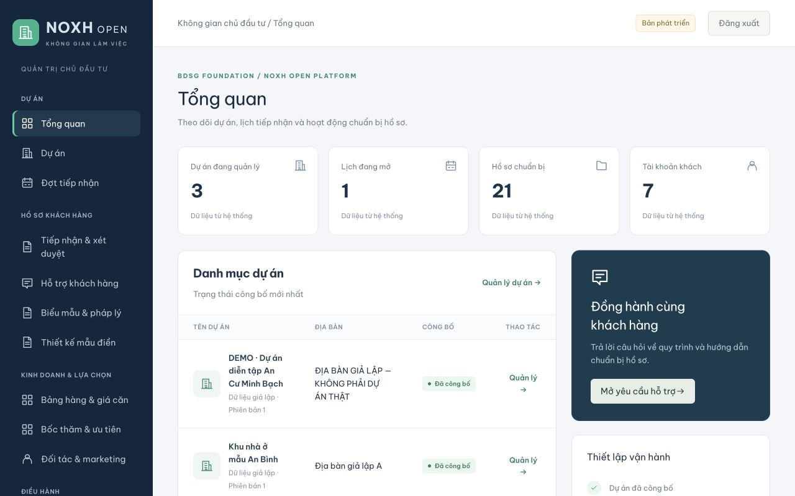
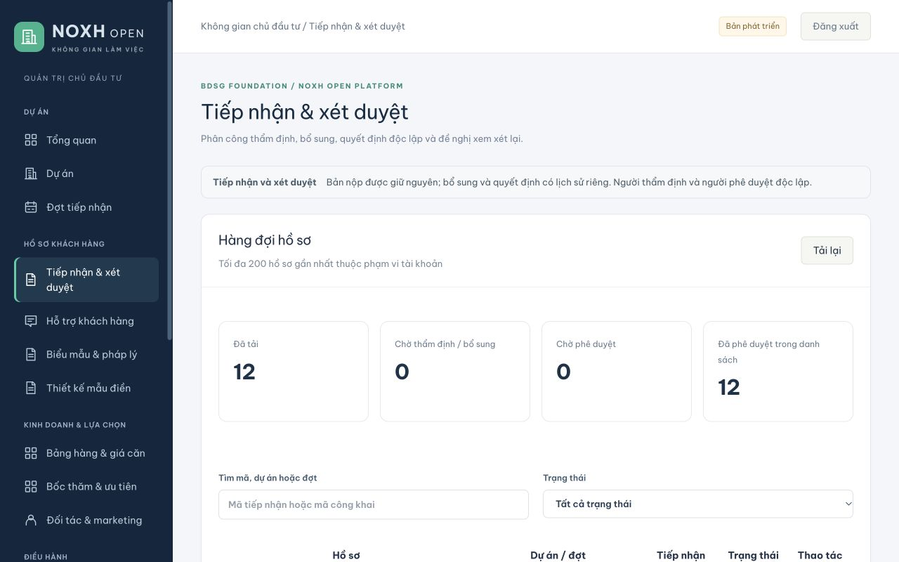

### Điều hành và bảng hàng

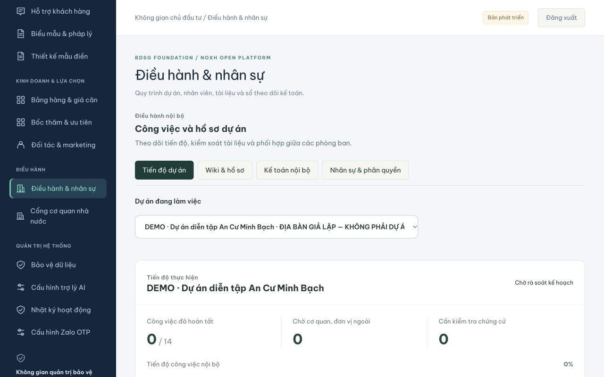
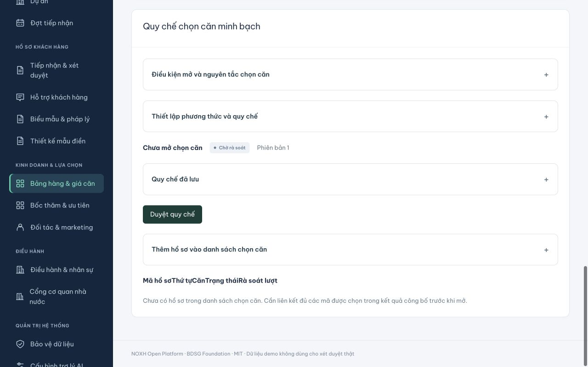

### Khách hàng, đối tác và minh bạch

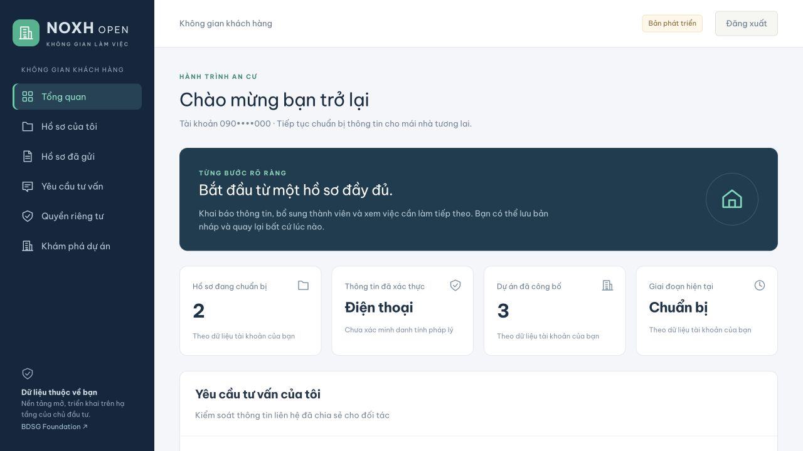
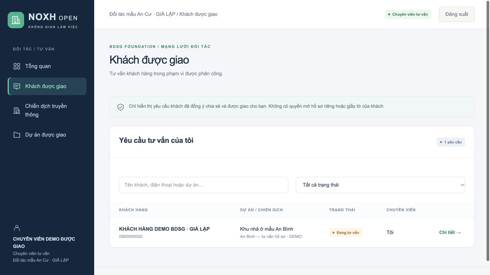
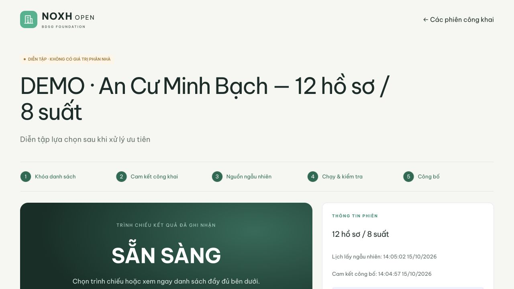

### Hồ sơ AI và quản trị hợp đồng

Ảnh bản hoàn thiện 16/10/2026 dùng tài khoản và dữ liệu tổng hợp. AI chỉ đề xuất; khách xác nhận trước khi tạo tài liệu.

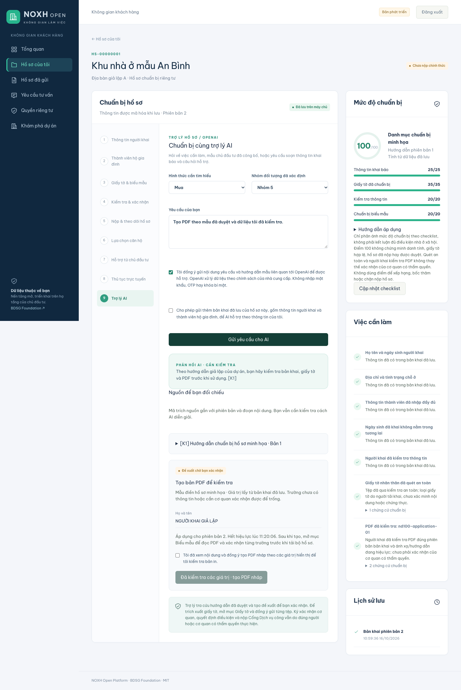
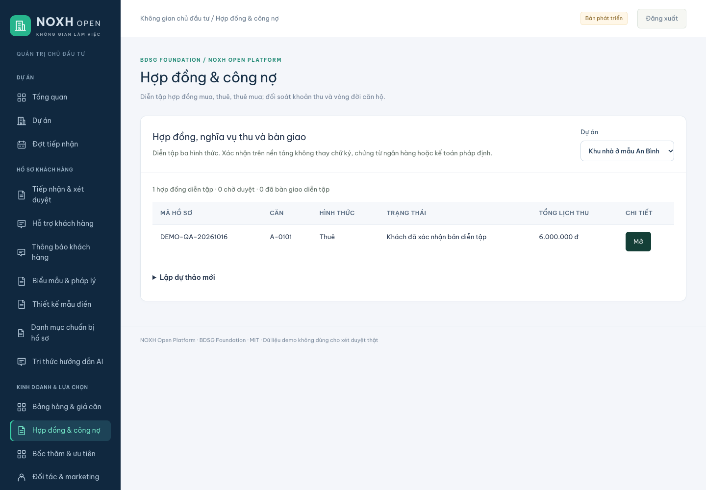
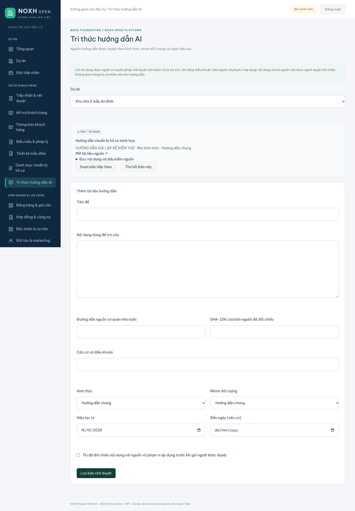

### Thông báo tự động và hộp thư khách hàng

Bản 021 dùng dự án và tài khoản giả lập. Chính sách có người duyệt độc lập; sự kiện hồ sơ đi qua outbox và worker thực tới hộp thư trong ứng dụng, theo lựa chọn hiện hành của khách. Không gửi email/Zalo hoặc thông báo pháp lý thật.

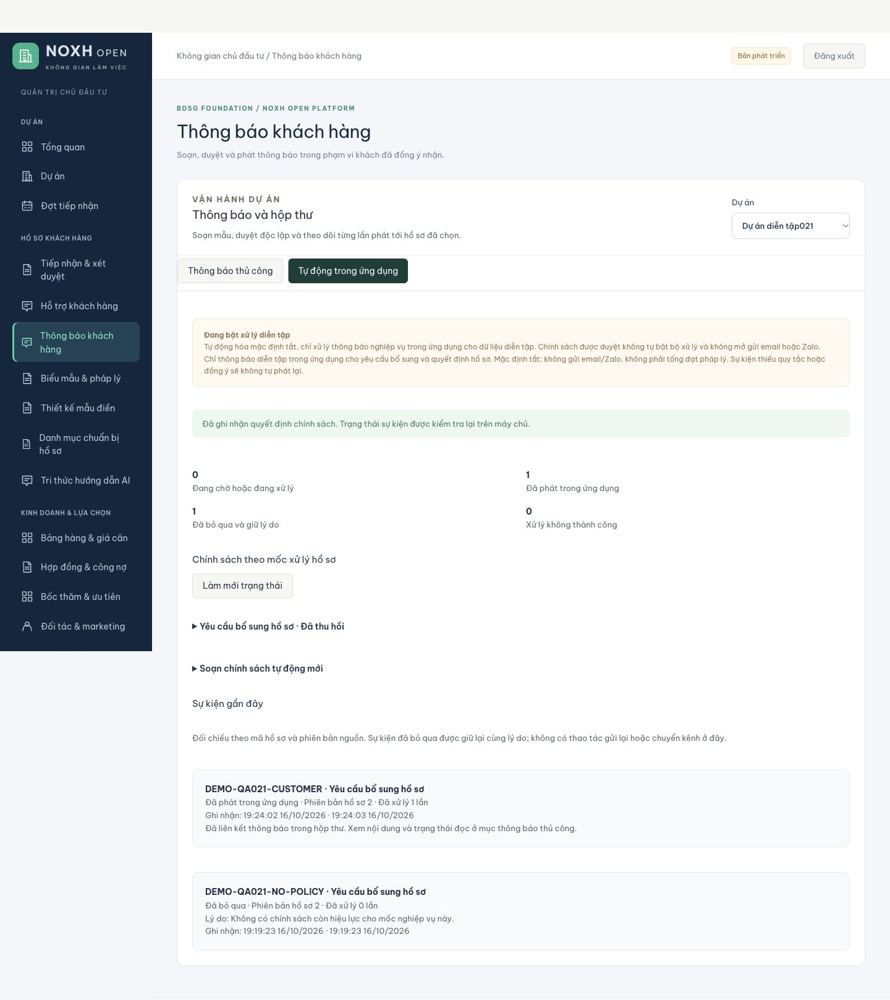
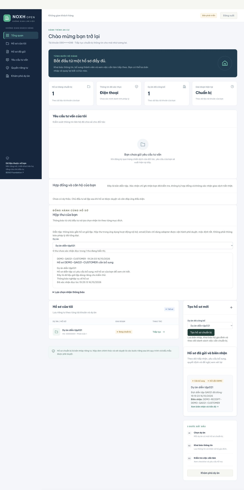

Xem [danh mục ảnh và phạm vi kiểm tra](docs/screenshots/README.md).
