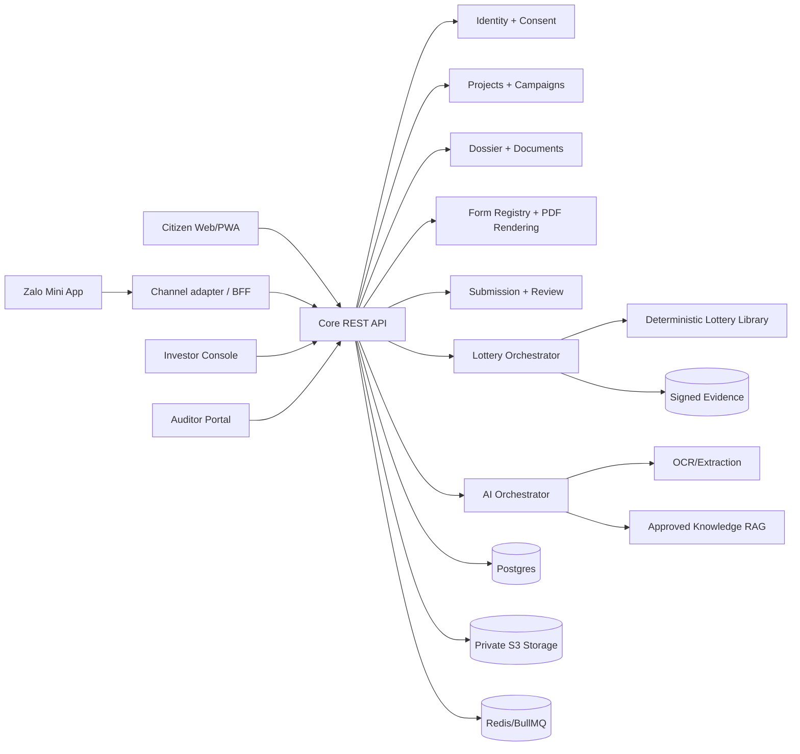
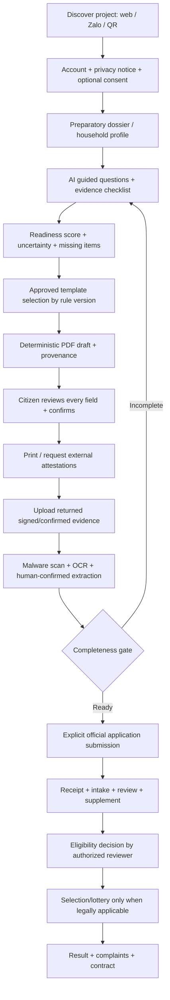
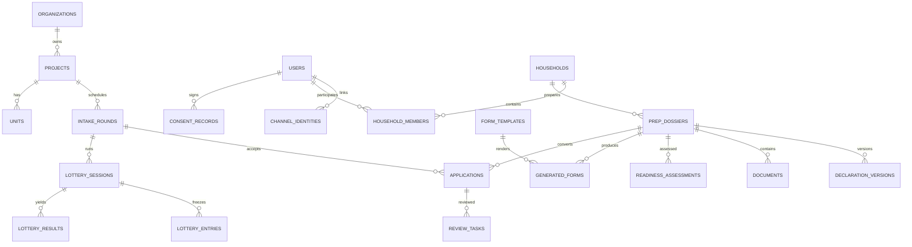

# NOXH Open Platform — Codex Implementation Blueprint v2.0

Status: PROPOSED / NOT LEGALLY CERTIFIED. Target: self-hosted, one investor with multiple projects, citizen web + Zalo Mini App. Language: Vietnamese-first. Updated 2026-10-14.

## Product invariants
1. Citizen profile and preparatory dossier are distinct from a legally submitted application.
2. AI can draft, extract, explain and score *completeness/readiness*; it must not determine statutory eligibility, fabricate facts, forge stamps/signatures, or influence lottery odds.
3. Official forms are immutable, approved, effective-dated templates. Never let an LLM invent form layout or legal text.
4. Zalo identity is a login link, not proof of legal identity; backend verifies Zalo-issued tokens server-side using current official integration contract.
5. Web and Zalo use the same API and canonical data; app-specific BFF adapters only.
6. Every sensitive state transition is authorized, versioned, audited and idempotent.
7. All personal documents are private, encrypted and scanned; no PII in analytics, traces, prompts by default or public lottery artifacts.
8. One organization, multiple projects; project-scoped RBAC/ABAC. Design organization_id for later multi-tenancy, but do not prematurely implement cross-organization sharing.
9. Lottery is a separately audited deterministic engine with independently verifiable artifacts; do not enable real-world draws before legal approval and independent audit.
10. Self-hosted means no required cloud AI or proprietary external service for core workflows; Zalo itself is an optional channel.

## Context map

## Citizen journey and explicit gates

## Bounded contexts and ownership
- Identity: users, channel identities, login sessions, MFA, account linking; Keycloak for workforce, citizen identity broker/BFF for Zalo; never auto-merge on phone number alone.
- Consent: notices, purpose-specific consents, version, withdrawal, retention policy, processing record.
- Projects: projects, buildings, units, campaign/publication, intake rounds.
- Dossier: person/household declarations, provenance, versions, preparatory dossier, document checklist.
- Forms: legally approved templates, field mappings, rule/version/effective date, generated PDFs and signatures.
- Applications: official submission, receipt, supplements, immutable submitted snapshot.
- Reviews: assignments, rule evaluations, approvals, appeal/reconsideration.
- Lottery: eligibility snapshot, commitments, entropy, execution, certification, results, verifier.
- Communications: opt-in, notification templates, channel-specific delivery adapters, retry and receipts.
- AI: prompt registry, approved knowledge, tool permissions, extraction jobs, structured outputs, human acceptance.
- Audit: append-only events, signed checkpoint and off-host replication.

## Core relational ERD

All sensitive tables: UUID PK, organization_id/project_id as applicable, created_at, updated_at, version; FKs and unique constraints; use database transactions and optimistic concurrency. Application submission stores immutable declaration and document hashes. Separate encrypted PII from public identifiers. Use partial unique index to prevent simultaneous active allocation of one unit.

## Core entities (minimum fields)
- users(id, keycloak_subject nullable, status); channel_identities(id,user_id,provider,provider_subject,verified_at,linked_at,unique(provider,provider_subject)).
- households(id,owner_user_id); household_members(id,household_id,person_ref,relationship,valid_from,valid_to).
- prep_dossiers(id,household_id,project_id nullable,phase,status,version); declaration_versions(id,dossier_id,schema_version,encrypted_payload,created_by,source).
- documents(id,dossier_id,type,object_key,sha256,mime,scan_status,verification_status,version,retention_class).
- readiness_assessments(id,dossier_id,checklist_version,score,missing_items_json,uncertainties_json,model_version,created_at).
- form_templates(id,form_code,legal_basis,version,effective_from,effective_to,approved_by,approved_at,sha256,source_uri,status).
- generated_forms(id,dossier_id,template_id,input_version,output_key,sha256,status,confirmed_at,confirmed_by).
- applications(id,dossier_id,round_id,submission_snapshot_hash,submitted_at,receipt_code,status,version).
- review_tasks(id,application_id,assignee_id,decision,reason_code,evidence_refs,status).
- lottery_sessions(id,round_id,ruleset_hash,snapshot_hash,commitment,entropy_source,algorithm_version,status); lottery_entries(session_id,application_id,group_code,public_token); lottery_results(session_id,application_id,rank,result_type); audit_events(id,actor,action,resource,prev_hash,event_hash,created_at).

## Readiness score specification (not eligibility)
Use deterministic checklist scoring, not a generative LLM numerical judgment. Example categories: declarations 25%, required documents 35%, internal consistency 20%, form preparation 20%. Unknown/unverified fields do not count as confirmed. Return category subscores, checklist version, missing tasks, reason codes, evidence links and disclaimer. No scoring for protected characteristics, no ranking citizens for lottery or access to housing. Each project/round may have a legally reviewed checklist version. AI suggests missing items and explanations; rule engine computes score. Score never blocks official submission by itself.

## Form pipeline
1. Legal admin registers source form and exact authoritative reference; legal reviewer approves hash, version, jurisdiction and effective dates.
2. Field-mapping schema explicitly declares source path, transforms, requiredness, validation and whether an item requires external confirmation.
3. Renderer populates approved DOCX/PDF template deterministically; preserve original fixed legal wording, margins and layout; missing required values remain visibly blank, never hallucinated.
4. Generate preview with watermark DRAFT until user checks all fields; capture consent/confirmation and input snapshot hash.
5. Download print-ready PDF with form/template version, generated timestamp and tracking ID; do not misrepresent as digitally signed or government-certified.
6. Upload attested scans, OCR into suggestions, highlight discrepancies; citizen/human reviewer accepts corrections; never overwrite original scans.
7. Revoked or superseded templates cannot be used for new drafts; existing artifacts remain retained with provenance.

## AI threat boundary
- AI worker receives only task-scoped, redacted payloads and short-lived document access. Disable external LLM egress by default.
- Prompt injection: documents and web pages are untrusted data; never allow them to modify system instructions, permissions, form registry or workflow.
- Structured outputs validated against JSON Schema/Zod; tool calls allowlisted and scoped; no direct write to authoritative decisions.
- Maintain prompt/model/knowledge versions, citations, confidence and human feedback. No model training on citizen data without separate lawful basis and explicit governance.
- OCR failures, ambiguous handwriting, contradictory documents and low confidence always route to human confirmation.

## Authentication and Zalo integration
- Use official Zalo Mini App SDK for user authorization, requesting only necessary permissions; follow current provider review and notification rules.
- Mini App calls backend with Zalo token over TLS; backend verifies token with the documented trusted verification method and maps provider_subject to internal user; do not accept a client-supplied user ID as proof.
- Issue short-lived first-party session with rotating refresh tokens or server-side session; CSRF defense for cookies; secure, httpOnly, SameSite where applicable.
- Web identity linking requires re-authentication of both accounts and an explicit confirmation step. Never merge by matching names/phone alone.
- Adapter interfaces: ChannelAuthProvider, ChannelNotificationProvider, ChannelDeepLinkProvider, ChannelFilePicker. Feature-detect Zalo SDK; web fallback always available.
- Never assume Mini App can silently obtain phone/name; permissions vary and must be requested as needed.

## API contract (v1)
Public: GET /projects, /projects/:id, /projects/:id/rounds, /public/forms/:code/metadata.
Identity: POST /auth/zalo/exchange, /auth/link/start, /auth/link/confirm, GET /me, POST /consents.
Dossier: POST /dossiers, GET /dossiers/:id, PATCH /dossiers/:id/declarations (If-Match), GET /dossiers/:id/checklist, POST /dossiers/:id/readiness, POST /dossiers/:id/documents/presign, POST /dossiers/:id/documents/complete.
AI: POST /ai/dossiers/:id/guide, POST /ai/documents/:id/extract, GET /ai/jobs/:id; jobs async with explicit status.
Forms: GET /form-templates?effectiveAt=, POST /dossiers/:id/forms/:templateId/generate, GET /generated-forms/:id, POST /generated-forms/:id/confirm.
Applications: POST /rounds/:id/applications (Idempotency-Key), GET /applications/:id, POST /applications/:id/supplements, GET /applications/:id/receipt.
Staff: GET /review/tasks, POST /review/tasks/:id/assess, POST /review/tasks/:id/approve, POST /rounds/:id/finalize.
Lottery: POST /lotteries, /lotteries/:id/freeze, /commit, /reveal, /execute, /certify, /publish; GET /lotteries/:id/manifest, /evidence, /results.
All writes: authentication, ABAC, validation, rate limits, audit, idempotency where applicable. Return RFC9457 Problem Details. Generate OpenAPI 3.1 and typed clients.

## RBAC and separation of duties
Roles: citizen, intake_officer, reviewer, approver, project_manager, form_legal_editor, form_legal_approver, lottery_operator, lottery_supervisor, auditor, infra_admin, org_admin. Every grant scoped by project or organization; owner-only access for citizen dossiers. Form editor cannot approve own template. Reviewer cannot approve own recommendation. Lottery operator cannot certify own draw. Infra admin cannot view PII by default. All privileged access MFA, time-bound elevation and immutable audit.

## Lottery protocol (production gated)
Two distinct modes: select applicants, allocate units. Freeze legally approved groups, priority treatment, eligibility and rules. Canonicalize and hash snapshot; publish commitment before independent entropy is known. Use HKDF-SHA256 with domain separation and specified CSPRNG, unbiased Fisher-Yates using rejection sampling; serialize exact algorithm and vectors; no retries to cherry-pick. Publish pseudonymous verifier package and signed evidence. Independent auditors and legal owner must sign off before live use. Human-controlled dispute/void workflow preserves prior events. Never publish PII.

## Security baseline
Threat model using STRIDE + privacy impact assessment; OWASP ASVS Level 2 target (higher controls for sensitive endpoints), OWASP API Top 10, supply-chain SLSA-oriented controls. TLS, HSTS, CSP, CSRF, rate limits, least privilege, field-level encryption for sensitive PII, encrypted backups, private S3, antivirus/quarantine, malware-resistant PDF rendering, audit hash chain and off-host checkpoint, secret manager, signed container images, SBOM, dependency pinning, CodeQL/Trivy, disaster recovery restore drill. Redact PII from logs and error traces. Retention and deletion rules approved by legal counsel; no blanket permanent retention.

## Self-host deployment
Dev: Docker Compose (Postgres, Redis, Keycloak + dedicated Postgres DB, S3-compatible storage, API, worker, citizen web, investor web, transparency web, optional AI worker). Prod: pinned digests, TLS reverse proxy, no start-dev, dedicated service credentials, secret injection, encrypted volumes, off-host backups, monitoring, capacity tests. Default external AI disabled. Separate local dev fixtures from real citizen data. Keycloak and object storage must have durable volumes and restore runbooks.

## Acceptance tests
- Citizen starts dossier in Zalo and resumes on web after secure linking; no data duplication.
- Draft PDF exactly follows an approved versioned template; user confirmation and hashes preserved.
- OCR mismatch triggers human confirmation; cannot silently alter declarations.
- Readiness score recomputable, explainable, versioned; never used for lottery selection.
- No cross-project access, including guessed UUIDs and object URLs.
- All sensitive transitions produce audit event; test tampering detection.
- Official application submission is idempotent and immutable snapshot is reproducible.
- Lottery verifier reproduces every result from published non-PII evidence and test vectors.
- Restore backup and run simulated multi-project load before go-live.

## Legal source registry / review gate
Before production, legal reviewers must map each form and rule to effective provisions, approved source files and dates. Starting sources (not an exhaustive current legal opinion): Housing Law 2023; Decree 100/2024/ND-CP; Decree 261/2025/ND-CP; consolidated Ministry of Construction document 24/VBHN-BXD (2026); current amendments and circulars governing form templates. Store legal citations, original signed attachments, review dates, and status. Do not ship guessed statutory thresholds or unapproved official forms.

## Architecture decision records (initial)
ADR-001 modular monolith NestJS + isolated workers; ADR-002 Postgres + row/project scoping; ADR-003 Keycloak workforce and channel identity broker; ADR-004 official template registry + deterministic renderer; ADR-005 AI advisory-only with local-first inference; ADR-006 verifiable lottery library + independent verifier; ADR-007 self-hosted Compose baseline; ADR-008 transactional outbox and durable jobs; ADR-009 public privacy-preserving evidence; ADR-010 AGPL-3.0-or-later candidate, license review before release.
